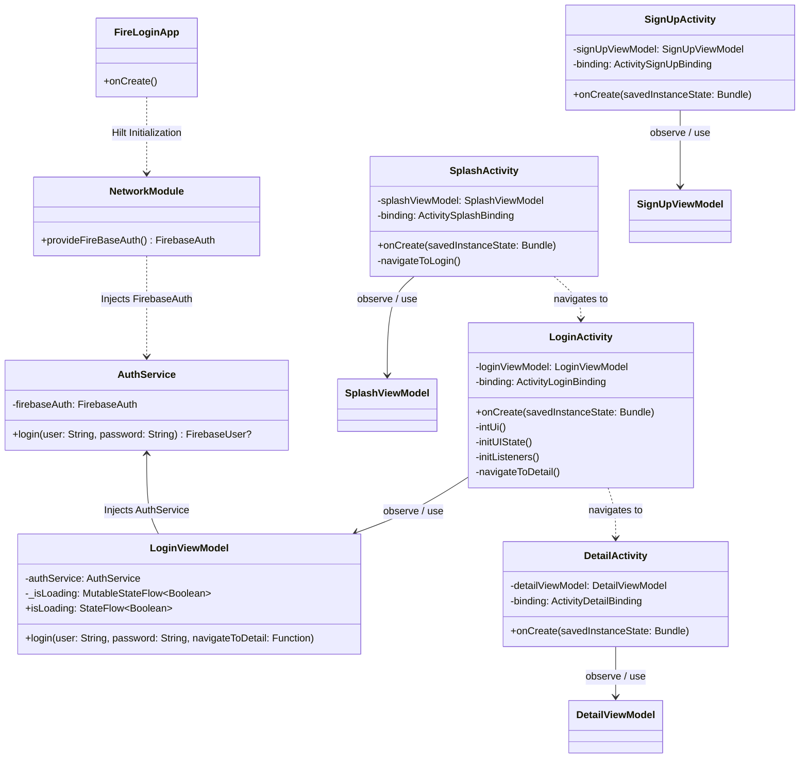

# Diagrama de Clases - FireLogin

Este documento contiene la arquitectura actual del proyecto **FireLogin** basada en **MVVM (Model-View-ViewModel)** e **Inyección de Dependencias con Hilt**.

---

## Resumen de la Arquitectura

### 1. **Capa de Aplicación y DI (Inyección de Dependencias)**
* **`FireLoginApp`**: Clase principal que hereda de `Application` con la anotación `@HiltAndroidApp` para iniciar Hilt.
* **`NetworkModule`**: Módulo Hilt que provee la instancia Singleton de `FirebaseAuth`.

### 2. **Capa de Datos (`data`)**
* **`AuthService`**: Encargado de la comunicación directa con Firebase Auth. Recibe `FirebaseAuth` por inyección y expone métodos de autenticación (como `login()`).

### 3. **Capa de Presentación (`ui`) - MVVM**
* **Splash (`SplashActivity` / `SplashViewModel`)**: Pantalla inicial de carga que redirige a `LoginActivity`.
* **Login (`LoginActivity` / `LoginViewModel`)**: Maneja la vista de inicio de sesión con correo y contraseña. Observa el estado `isLoading` del ViewModel y comunica con `AuthService`.
* **Registro (`SignUpActivity` / `SignUpViewModel`)**: Pantalla para registrar nuevos usuarios.
* **Detalle (`DetailActivity` / `DetailViewModel`)**: Pantalla principal tras iniciar sesión exitosamente.
